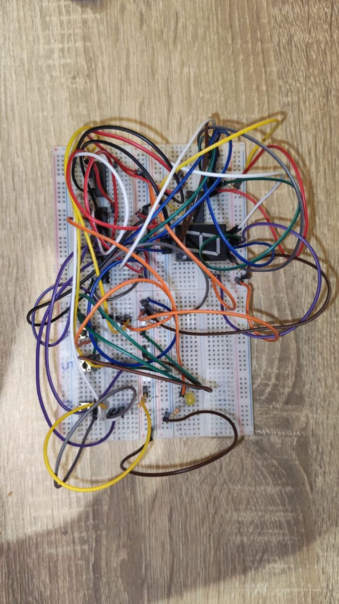
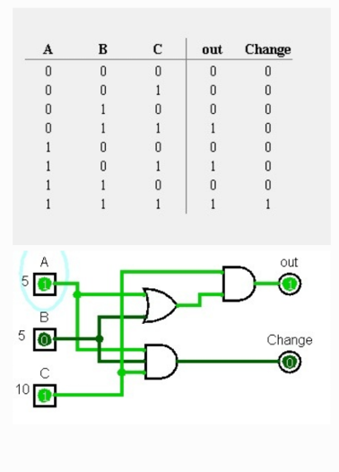
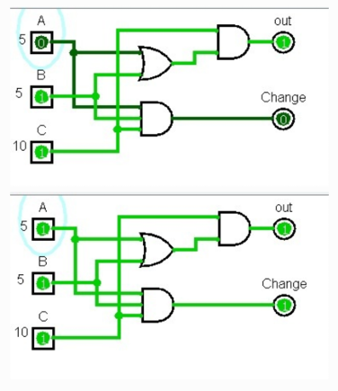

# Logic-Based Vending Machine Controller

## Overview
This project presents the comprehensive design and implementation of a digital logic-based controller for a simplified vending machine. The system handles transactions for a product priced at 15 currency units by accepting two coin denominations: 5 and 10. It evaluates three binary inputs in real-time to determine when the dispensing threshold is met and provides change (returning 5 units) when an overpayment (totaling 20) occurs.

**Institution:** Future University in Egypt - Faculty of Computer and Information Technology.
**Course:** CSC122: Logic Design (Spring 2026).

## Team & Roles
* **Issa Masoud Alagha (20254985):** Circuit drawing & hardware.
* **Ahmed Abdelwhab (20255255):** Simulation & testing.
* **Abdalla Sayed (20254791):** Report writing & truth table.

## System Specifications
### Inputs
* **Input A:** A binary signal representing the insertion of a 5-unit coin.
* **Input B:** A binary signal representing the insertion of a second 5-unit coin.
* **Input C:** A binary signal representing the insertion of a 10-unit coin.

### Outputs
* **Out Signal (Dispense):** A logical output that triggers the product dispensing mechanism (represented by an LED indicator). It activates when the sum of active inputs equals or exceeds 15.
* **Change Signal:** A logical output that activates the coin return mechanism (7-segment display). It is specifically triggered when the total input value is 20, signifying a 5-unit refund is required.

## Logic Design
The circuit logic is defined by the following minimized Boolean equations derived from Karnaugh Maps:
* **Dispense (Out):** Out = C.(A + B)
* **Change:** Change = A.B.C

## Hardware Implementation
The physical circuit was built to directly reflect the Boolean equations using the following components:
* Breadboard (4)
* IC 7432 (OR GATE) (1)
* IC 7408 (AND GATE 2 input) (1)
* IC 7411 (AND GATE 3 input) (1)
* IC 7404 (NOT GATE) (1)
* Press 4Pin Tactile Switches (3)
* Resistors (8)
* 7 Segment Common Anode (1)
* LED (1)
* Jumper wires

## Simulation
The logic was successfully implemented and validated in Logisim using AND and OR gates for exact payment (15) and overpayment (20) scenarios.

## Repository Structure
* `/Documentation`: Contains detailed PDF reports for the project phases and the final comprehensive project report.
* `/Circuit`: Contains the `.circ` Logisim simulation file and screenshots of the circuit design.

## Circuit Overview

**Hardware Implementation Preview:**

**Logisim Simulation - Exact Payment (15):**

**Logisim Simulation - Overpayment (20):**

